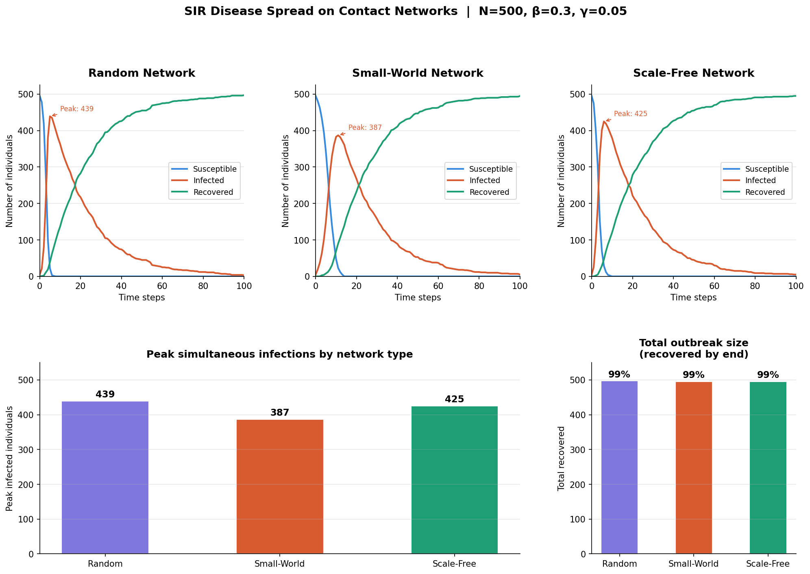

# SIR Disease Spread Simulator on Contact Networks

A Python simulation of infectious disease dynamics using the **SIR (Susceptible-Infected-Recovered)** model on three types of contact networks. Built as part of my MSc Mathematics research in network science and epidemiology at Sefako Makgatho Health Sciences University.

---

## What this project does

This simulator models how a disease spreads through a population depending on the **structure of the contact network** — who is connected to whom. The same disease parameters (transmission rate, recovery rate) produce very different outbreak patterns depending on whether the underlying network is random, small-world, or scale-free.

Three network types are compared:

| Network | Description | Real-world analogy |
|---|---|---|
| **Random (Erdos-Renyi)** | Each pair connected with equal probability | Random mixing in a population |
| **Small-World (Watts-Strogatz)** | High clustering, short path lengths | Social friend groups with occasional long-range links |
| **Scale-Free (Barabasi-Albert)** | Few highly connected hubs, many low-degree nodes | Air travel networks, social media |

---

## Results



Key findings from default parameters (N=500, β=0.3, γ=0.05):

- The **small-world network** produces the lowest peak infection (387 vs 439 for random) due to high local clustering slowing early spread
- The **scale-free network** spreads faster initially due to super-spreader hubs, but follows a similar trajectory
- All three networks reach ~99% total outbreak size at these transmission rates — illustrating that **network structure primarily affects the speed and shape of the epidemic curve**, not necessarily the final size when β is high

---

## Installation

```bash
git clone https://github.com/LesegoMasilela/sir-network-simulator.git
cd sir-network-simulator
pip install -r requirements.txt
python sir_simulator.py
```

---

## Requirements

```
numpy
networkx
matplotlib
```

Or install directly:
```bash
pip install numpy networkx matplotlib
```

---

## Parameters

All parameters are defined at the top of `sir_simulator.py` and easy to modify:

```python
N          = 500    # Population size
BETA       = 0.3    # Transmission probability per contact per time step
GAMMA      = 0.05   # Recovery probability per time step
STEPS      = 100    # Simulation duration
SEED       = 42     # Random seed (for reproducibility)
INITIAL_INFECTED = 5  # Number of initially infected individuals
```

Try reducing `BETA` below the epidemic threshold to observe outbreaks that die out before spreading.

---

## How the SIR model works

At each time step:
1. Each **Infected** node attempts to transmit to each **Susceptible** neighbour with probability `β`
2. Each **Infected** node recovers (moves to **Recovered**) with probability `γ`

The **basic reproduction number** R₀ ≈ β/γ × average_degree. When R₀ > 1, an epidemic occurs. When R₀ < 1, the disease dies out.

---

## Project context

This project extends my MSc Mathematics research at SMU, where I study epidemic dynamics on structured contact networks. My honours research focused on spectral graph theory and energy invariants of networks — the structural properties investigated here (degree distribution, clustering, path length) are closely related to the spectral properties I studied at honours level.

---

## Author

**Lesego Masilela**
MSc Mathematics — Network Science & Epidemiology
Sefako Makgatho Health Sciences University, Pretoria

[LinkedIn](https://www.linkedin.com/in/lesego-masilela-58a62a18a) · [GitHub](https://github.com/LesegoMasilela)
